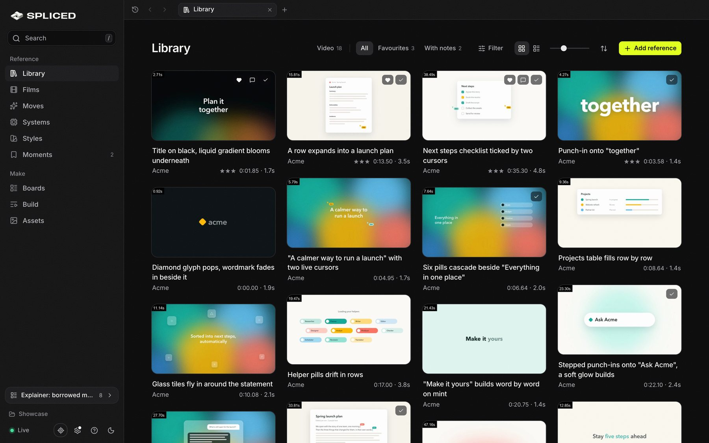
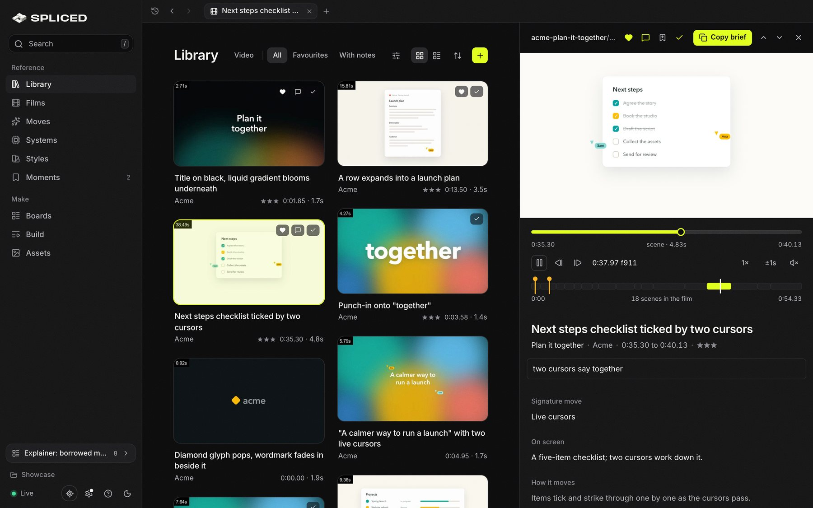
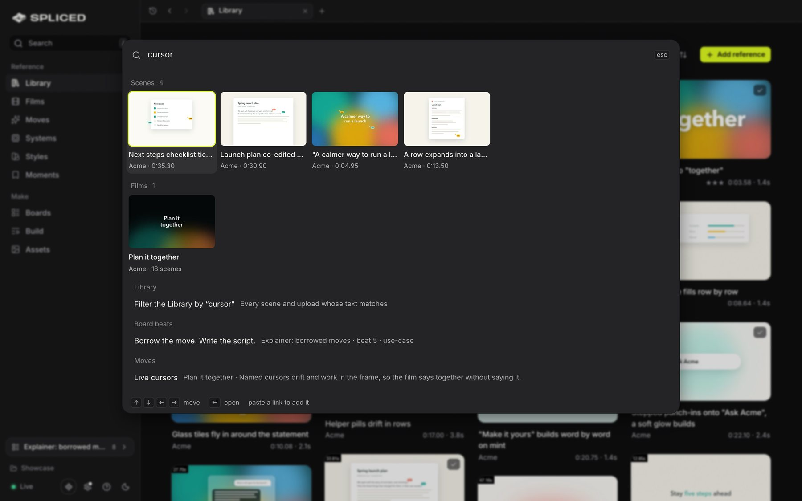
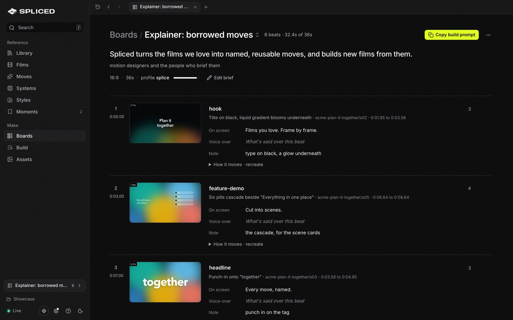
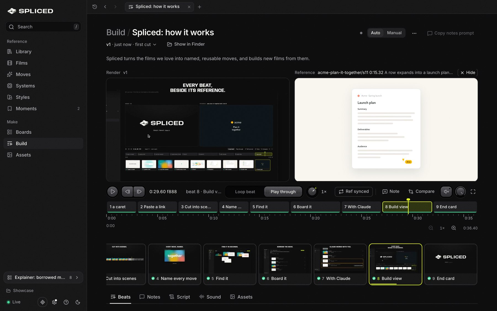

# Spliced

A workshop for motion design. Study the films you love scene by scene, name their moves, collect the scenes
you want on a board, and build your own film from them, with your own AI doing the work beside you.

Spliced is a local app, a set of pipelines and a few skills. It does no AI work itself: your agent (Claude Code
today; others through the same plain commands) reads the films, writes the breakdowns, builds the film and
answers your notes. Everything stays in a folder on your machine.

**Status: pre-release.** It works, it is tested, and it is still being shaped. Expect names to move.



<table>
  <tr>
    <td width="50%"></td>
    <td width="50%"></td>
  </tr>
  <tr>
    <td><b>A scene, read closely.</b> Play it frame by frame, see where it sits in its film, and read how it moves and how to make it.</td>
    <td><b>Find it in seconds.</b> One search across scenes, films, board beats and named moves.</td>
  </tr>
  <tr>
    <td width="50%"></td>
    <td width="50%"></td>
  </tr>
  <tr>
    <td><b>Board it.</b> Line up the scenes you want to borrow and write the script beside them.</td>
    <td><b>Build it.</b> Your film, beat by beat, next to the reference each beat came from. Leave a note on a frame and your AI picks it up.</td>
  </tr>
</table>

The pictures are of a made-up film for a made-up company, drawn in code. Nothing in them is anyone's real work.

## Start

Open your AI (Claude Code, Codex, Cursor or Gemini CLI) in a new, empty folder and paste this:

> Set up Spliced in this folder: run `npx -y spliced-app setup`. If `npx` isn't found, install Node.js first. If it
> says uv is missing, install uv the way it tells you and run it again. Then fix what `npx -y spliced-app doctor`
> marks ✗, telling me what each fix installs before you run it, and leave the lines marked · alone. Finish by telling
> me what to do next.

About a minute later you have a project, your AI has Spliced's skills and tools, the example film is rendered, and
the app is open in your browser. `setup` is safe to run again: it only does what is still missing, and after an
update of Spliced it brings the project's skills and film kit up to date.

By hand it is the same one command: `npx -y spliced-app setup my-films`.

**What it needs.** macOS or Linux (Windows is not supported yet). [Node.js](https://nodejs.org/en/download) 18 or
newer, for the command above and for rendering. [uv](https://docs.astral.sh/uv/getting-started/installation/), which
runs Spliced's tools and fetches Python for them. To add films from a link you also want `ffmpeg` and `yt-dlp`:
`spliced doctor` gives the command for your machine (with no Homebrew, `uv tool install static-ffmpeg` needs no
password). Nothing else is required: no account, no service key.

Other ways in:

- **Installed once**: `npm install -g spliced-app` gives you a `spliced` command, then `spliced setup my-films`.
- **Without npm**: `uv tool install git+https://github.com/multiplyco/spliced` gives the same `spliced` command.
- **The Mac app**: download `Spliced-<version>.dmg` from the latest release (see [mac/README.md](mac/README.md)). It
  opens each project in its own window and carries the engine inside it, so no terminal is needed.
- **From a checkout**, to work on Spliced itself:

```bash
git clone https://github.com/multiplyco/spliced && cd spliced
uv tool install --editable .        # gives you the `spliced` command; edits to the checkout are live

spliced setup ~/films/mine          # a project, your AI's skills, the film kit, the example film, the app
cd ~/films/mine
spliced doctor                      # what is set up on this machine, and the step that unlocks the next thing (in the app: Setup)
spliced reference add "<link>"      # your first reference film: downloaded and analysed
spliced import ~/Movies/references  # or a folder you already have: says what is in it; --go brings it in
```

Without installing, `uv run spliced/cli.py <command>` from the checkout is the same thing. `spliced init <folder>`
makes only the project, for when you want the other steps one at a time.

## A project

A project is a folder with a `spliced.json`. Run commands from inside it, or pass `--project <folder>`.

| In the project | What |
| --- | --- |
| `spliced.json` | Its name, whose films these are (`brand`), motion profiles it adds, who reads imports (`agent`), and where your app's real code is (`app`) |
| `library/` | Reference films broken down scene by scene, your uploads, your boards and reviews (`state.json`) |
| `profiles/` | The looks your films are made in, one folder each (Profiles) |
| `reference/` | The downloaded films |
| `remotion/`, `videos/` | Films in production, if you make them here |
| `.cache/`, `.env` | Rebuilt on demand; your API keys. Neither is ever served or committed |

## Your AI

`spliced agents install` gives the project's AI what it needs: Spliced's skills (in `.claude/skills/`), a section
in the project's `AGENTS.md` that says how to work here, and Spliced's MCP server in `.mcp.json`. In the app it is
Setup, Connect your AI. A skill file you change is yours: later installs and updates leave it alone
(`--force` replaces it and keeps your version in `.cache/skills-kept/`).

`spliced setup` does this as one of its steps. An agent with a shell uses the `spliced` command. The MCP server offers the same to agents without one: search
the library, read a scene with its frames, read and edit boards, a film's plan and notes, the import queue.
Claude Code picks it up from `.mcp.json`; Gemini CLI from `.gemini/settings.json` (and reads `AGENTS.md` through
`GEMINI.md`), both written by `spliced agents install`; for Codex, `codex mcp add spliced -- spliced mcp`.

Chat apps don't open a folder, so they keep their own list of tools. `spliced connect` adds this project to them,
as `spliced-<project>`: `spliced connect claude-desktop` (the Claude desktop app; quit and reopen it), `cursor` or
`codex`, `--remove` to take it out, `--dry-run` to see what would change. With no app named it says which are
connected. It keeps everything else in the app's settings, and the file as it was before the first change.
A render takes minutes, so it is started and then asked about: `spliced film render <slug> --background`, then
`spliced film render-status <slug>` (the `film_render` tool does the same).

When you add a film, Spliced downloads it and runs the machine pass (cuts, tempo, palette, contact sheets). The
breakdown is your agent's work, and by default nothing starts on its own: the import waits, and you tell your
agent to pick it up (`spliced imports next`). If you would rather have it happen in the background, say so in
`spliced.json`:

```json
{ "agent": { "runner": "claude", "permissions": "ask" } }
```

The app calls your AI "Claude" when the project has Claude read its imports, and "your AI" otherwise; `"agent": {"name": "..."}`
sets your own name for it.

`ask` fences the background session in: it may read, edit files in the project and run Spliced's own commands,
nothing else. `bypass` removes the fence. A film's page is content from the internet, read by an agent, so
choose that knowingly.

## Making films

Spliced's film kit is a Remotion setup for making product films from your boards: a motion library where a film asks
for roles (enter, move, camera) and a **motion profile** decides the curves, every move as a specimen (the Systems
view), recipes for craft and sound, and a set of UI sounds.

```bash
spliced kit install              # into remotion/, with its packages (Remotion, React) from npm
spliced kit packages             # a clone without them: install them (opening the project in Spliced does it too)
spliced kit starter              # the example film (Spliced's own introduction), to read, render and borrow from
spliced kit update               # after updating Spliced: its files replaced with the new ones
```

The kit's files (`remotion/src/lib`, `src/specimen`, `docs/CRAFT.md`, `MOTION-SYSTEMS.md`, `SOUND.md`, the UI sounds)
are Spliced's, and `update` replaces them; a file you changed by hand is listed and left alone. Your films, your
`Root.tsx` and your own motion profiles (`remotion/src/profiles.ts`) are yours and never touched. Your profiles reach the
kit as code in `remotion/src/profiles.generated.ts`, written by Spliced, so a film says `motion('acme')` and
`profileTokens('acme')` and writes no profile by hand. Ask your AI to make
a film and it follows the `make-film` skill (`spliced agents install` puts it in the project). Remotion is free for
individuals and small teams and needs a paid licence above that.

### Profiles

A profile is a look your films are made in: your company's own (its brand, type, sound direction) or a look you want
to try. Each one is a folder in the project, `profiles/<name>/`: its palette, its typefaces (chosen from the ones on
your Mac or from Google Fonts), its motion (a starting motion and what it changes: pace, bounce, stagger, and as
many scene changes and ways for words to arrive as fit), its own words in `PROFILE.md`, the scenes that show the look, and the rules your AI learns
while making films ("never bounce the logo"). Your AI reads it before the kit's defaults. A motion you have tuned can
be saved, and any profile can start from it (`spliced profile save-motion`, `profile motions`).

Drop a brand book, a logo, screenshots or a film on Profiles and your AI drafts a profile from them: the files go into
the profile's `sources/`, and the reading is an import like a film's breakdown (`spliced profile draft "<name>"
<files>`; your AI picks it up with `spliced imports next`, or a background session does when `spliced.json` asks for one).
Give it a website instead (type the address, or drag a link onto Profiles; `spliced profile draft "<name>" acme.com`)
and Spliced reads that one page first: the colours and typefaces its CSS really uses, how it moves, its words, its logo,
and screenshots when Chrome, Chromium, Edge or Brave is installed (headless, in a browser profile of its own). It opens
only that page, its stylesheets and its pictures, and only when you ask.

Before your AI reads them, Spliced digests a profile's sources into its `digest/` (`spliced profile digest`): a PDF's
text and pages on one sheet, every picture taken out and measured (cut-out, photo or backdrop, where the subject sits,
a device's screen, its colours), SVG logos cleaned, and the colours, typefaces and products a JSON or HTML export holds.
It downloads nothing, unless you add `--fetch`: then it fetches the picture addresses those files list, once each.

Briefs start in the default profile. Every brief you copy (a board's build prompt, a scene, a whole reference film) can
choose another, or **No profile**: then the film recreates its references as they are, in their own look. In the app:
Profiles, under Make. A project from before profiles keeps its brand and `remotion/docs/HOUSE.md`; `spliced setup`
makes them its first profile.

## Commands

`spliced` with no arguments lists them. The ones you will use most:

| Command | What |
| --- | --- |
| `spliced setup [<folder>]` | Everything in one go, or a project brought up to date after an update |
| `spliced doctor` | What is set up, level by level: browse, collect, analyse, make films, generate |
| `spliced open` | The app. `--background` starts it and gives the terminal back; `--stop` stops it |
| `spliced update` | Whether a newer Spliced is out, and the command that gets it |
| `spliced projects` | The projects you have opened on this machine, and which are running (in the app: the project's name in the sidebar) |
| `spliced reference add <link or file>` | Add a reference film |
| `spliced import <folder>`, `--go` | Look at a folder of pictures, clips and films you already have; bring it in, each thing once |
| `spliced imports list`, `next`, `done <id>` | The import queue, and an agent picking a job up |
| `spliced board find "<words>"`, `show "<board>"` | Search the library; read a board as a script |
| `spliced profile`, `show <profile>`, `new`, `draft`, `learn` | The looks your films are made in, the default marked; what your AI reads before building in one; a profile drafted from a brand book or film |
| `spliced film status <slug>`, `render`, `note` | A film in production, beat by beat |
| `spliced library --check` | Is every breakdown valid? |
| `spliced keys`, `keys set <service>` | Which service keys the project has (ElevenLabs, footage libraries); paste one into `.env` without it showing |

## Services are extras

Nothing outside your machine is needed to study films, build boards and make a film: the motion library, the UI
sounds and free footage (NASA, Openverse) come with Spliced. Services give your AI more to work with, and each is
optional:

- **Voice-over**: an ElevenLabs key lets Spliced record a film's lines itself. Without one, your AI can use any
  voice service it is connected to, or you can record the lines yourself; `spliced voice file` takes the audio in
  either way. A film with no voice carries its words on screen.
- **Music**: a take is an audio file from anywhere: a music generator your AI is connected to, a track you have the
  rights to, or none. `remotion/docs/SOUND.md` says how each is filed; the arranging to the cuts is the same for all.
- **Generated stills and clips**: any image or video generator your AI is connected to, used where real footage
  can't give the shot.
- **More footage**: free keys for Pexels, Pixabay or Unsplash, added under Settings, Service keys.

## Updates

Once a day, a running Spliced asks the npm registry for the newest version number. The request carries nothing about
you or your project. When a newer one is out, the app shows Update in the tab strip with the command that gets it,
and `spliced doctor` says so. `spliced update` asks now. To turn it off: `"updates": false` in `spliced.json`, or
`SPLICED_NO_UPDATE_CHECK=1`. Run through `npx`, Spliced is the newest each time it starts. After an update,
`spliced setup` brings a project's copies of Spliced's files (the skills, the film kit) up to date. The Mac app
checks for itself and installs the update.

The typeface picker's Google Fonts tab shows each family in its own face, so while it is open the page loads those
previews from Google Fonts (the request names the font, nothing about you or your project); a profile that uses a
Google font loads it the same way to show it. Spliced ships the list of names, not the fonts. To turn it off:
`"google_fonts": false` in `spliced.json`.

## Working on Spliced

```bash
python3 -m unittest discover tests     # state, paths, server, library build, imports, the command line
uv run tests/smoke.py                  # the app in a real browser, on the fixture project and on an empty one
```

`AGENTS.md` has the rules for changing the tool. The tests run on `tests/fixture`, a tiny project made by
`tests/make_fixture.py`; they never touch a project of yours.

The pictures at the top of this file are taken by `uv run scripts/readme_shots.py`, on a project it makes up in a
temporary folder. Run it again after a change to how the app looks.

## How Spliced is published

- **npm**: the package `spliced-app`, published by a person from a release's tag (`npm publish`). No workflow
  publishes anything or starts on its own with write access; the Mac app's release build runs only by hand.
- **Not on PyPI.** `pyproject.toml` carries the classifier `Private :: Do Not Upload`, which PyPI refuses, so a
  package of that name there is not Spliced. `uv tool install` takes it from this repository instead.
- The update check asks npm about `spliced-app` only while the package is published (`updates.PUBLISHED`, held to
  `package.json` by `tests/test_guard.py`).

This repository was started without the history of Spliced's private development.

## Your responsibility

Spliced is for studying how films are made, not for copying them. What you download, study and make with it is
yours to answer for:

- Only add films you have the right to download, and keep to the terms of the site they come from.
- Do not reuse anyone's footage, music, design or likeness without permission. A breakdown is for learning a move,
  not for lifting the work.
- Before you publish a film, check that you hold the rights to everything in it.

Spliced is provided as is, without warranty of any kind, and you use it at your own risk (sections 7 and 8 of
`LICENSE`). Multiply Potential AB, which makes Spliced, does not condone copyright infringement or the use of
anyone's work or likeness without permission and, to the extent the law allows, accepts no liability for how the
tool is used.

## Licence

Apache 2.0. See `LICENSE` and `NOTICE`. Making films with Remotion needs a Remotion licence of your own
above a certain company size; Spliced does not include Remotion.
