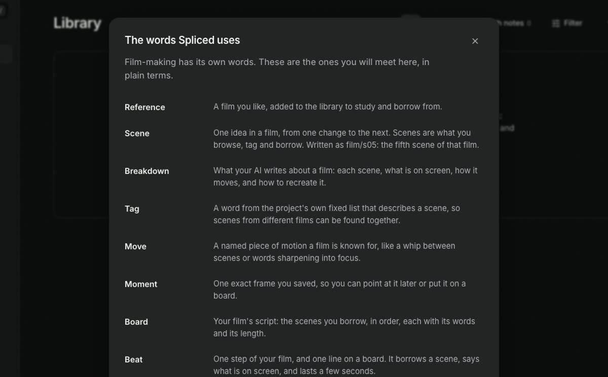

In the app, a word with a dotted underline shows its meaning when you point at it. The whole list opens from Settings, or with <kbd>⌘K</kbd>, **Glossary**.

## In the library

| Word | What it means |
| --- | --- |
| Reference | A film you like, added to the library to study and borrow from |
| Scene | One idea in a film, from one change to the next. Scenes are what you browse, tag and borrow. Written as `film/s05`: the fifth scene of that film |
| Breakdown | What your AI writes about a film: each scene, what is on screen, how it moves, and how to recreate it |
| Tag | A word from the project's own fixed list that describes a scene, so scenes from different films can be found together |
| Move | A named piece of motion a film is known for, like a whip between scenes or words sharpening into focus |
| Moment | One exact frame you saved, so you can point at it later or put it on a board |
| Strip | A scene's frames side by side, so you can see what happens in it without playing it |

## In a film of your own

| Word | What it means |
| --- | --- |
| Board | Your film's script: the scenes you borrow, in order, each with its words and its length |
| Beat | One step of your film, and one line on a board. It borrows a scene, says what is on screen, and lasts a few seconds |
| Motion profile | How everything in one film moves: how fast things arrive, whether they bounce. One per film, so it feels made by one hand |
| Storyboard | A film's plan, beat by beat, once you start building it from a board |
| Render | A video file made from the film as it stands. Each new one gets a version number, so you can compare |
| Cue | A time in the film where something happens, written down once so picture and sound agree |

## In sound

| Word | What it means |
| --- | --- |
| Take | One of several versions of a sound: a voice line read again, or another try at the music. You choose which one plays |
| Bed | The music that runs under a film |
| Stem | One part of the music on its own, such as the drums or the bass, so each can be heard and cut separately |
