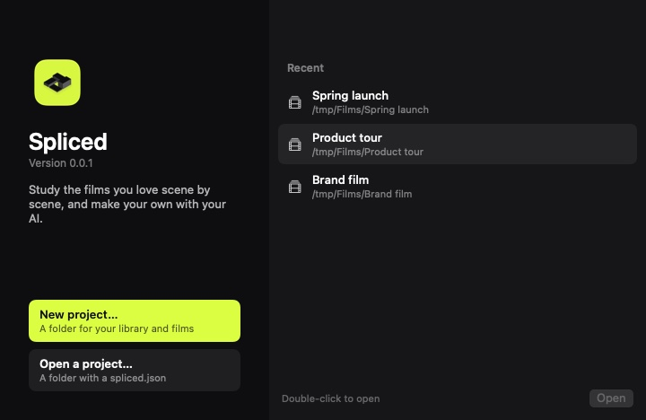

Spliced for Mac is a window around the same Spliced you know from the browser. Everything Spliced needs to run is inside the app: the engine and uv. It runs with your own Python 3.10 or newer if there is one, and otherwise has uv fetch one, once.



## Get it

Download `Spliced-<version>.dmg` from the [latest release](https://github.com/multiplyco/spliced/releases/latest) and drag Spliced to Applications. It runs on Apple silicon and Intel.

The app is not signed yet, so macOS refuses it the first time: allow it under **System Settings, Privacy & Security**.

## Projects as windows

- The start window lists your recent projects, opens a folder that is already a project, or makes a new one. A new project starts empty: run `spliced setup` in its folder (see The command line tool, below) for your AI's skills, the film kit and the example film.
- Each project opens in its own window, and the projects open when you quit open again at launch.
- Drop a project folder on Spliced in the Dock to open it.
- The project's name sits at the bottom of the sidebar, above the toolbar. Click it for the menu of projects: switch, open, make or close one. **File, Open Project** (<kbd>⌘O</kbd>) does the same, and <kbd>⇧⌘W</kbd> closes the project.

## What the window adds

| Feature | What it does |
| --- | --- |
| Folders | A folder dropped anywhere on the window opens Add references on it, and **Add a folder** is a native folder picker |
| Imports in the Dock | The Dock icon counts the imports running in every open project. A notification says when one finishes while you are in another app |
| Keys for the tab strip | <kbd>⌘</kbd> <kbd>[</kbd> and <kbd>⌘</kbd> <kbd>]</kbd> for back and forward, or a two-finger swipe, and <kbd>⌘Y</kbd> for Recently viewed |
| Downloads | Go to Downloads. Links to other sites open in your browser |
| Updates | The app installs a new version itself (below) |

The browser has its own versions of most of these: **Add a folder** opens your system's folder picker, the tab's title counts the imports that are running, a notification says when one finishes if you allow it, and the tab strip has the same back, forward and Recently viewed.

## Connect your AI

**Connect your AI**, in the Project menu or in Setup, is one sheet. It installs Spliced's skills for the agents that open the folder, and shows a box for each chat app it found on your Mac, ticked when already connected. See [Connect your AI](connect-your-ai.md).

## The command line tool

**Command line tool**, in the Spliced menu or in Settings, links `~/.local/bin/spliced` to the command inside the app, so the same Spliced works in a terminal.

## Updates

When a newer Spliced is out, the app shows **Update app** at the end of the tab strip, in the Spliced menu, in Settings and in the start window. It closes, updates and opens again with your projects.

## Build it yourself

```bash
mac/build.sh                         # build/Spliced.app, signed for this Mac
open mac/build/Spliced.app
open -a mac/build/Spliced.app ~/films/mine   # straight into a project
```

It needs the Swift toolchain (Xcode or the Command Line Tools) and uv. A copy built this way updates to the newest commits on its branch: **Update app** pulls them and builds the app again.
