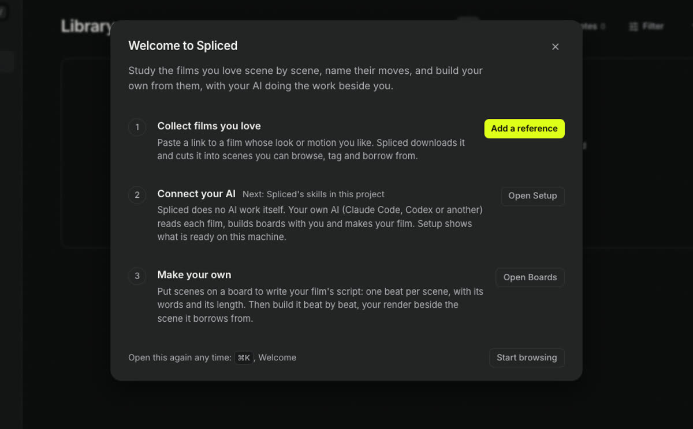

You need Spliced on your machine first: see [Install](install.md). If you would rather have your AI do all of this, the home page has [one message to paste](https://spliced.video/#works).

## 1. Set up a project

```bash
spliced setup ~/films/mine
cd ~/films/mine
```

One command does the first four things: it makes the project (a folder with a `spliced.json` in it), gives your AI Spliced's skills and tools, installs the [film kit](film-kit.md) with an example film already rendered, and opens the app. Run it again any time: it only does what is still missing. See [The project folder](project.md).

`spliced init` makes only the project, if you want the steps one at a time.

## 2. See what is set up

```bash
spliced doctor
```

It says what this machine and project can do now, and the step that unlocks the next thing. In the app the same list is [Setup](setup.md).

## 3. Open the app

`setup` opened it. To open it again later:

```bash
spliced open
```

The app opens in your browser. The server stays up until you press <kbd>Ctrl</kbd> <kbd>C</kbd>, or start it with `spliced open --background` to get the terminal back and stop it with `spliced open --stop`. The first time, a welcome shows three steps and a short film of how Spliced works.



## 4. Check your AI is connected

`setup` gave the project's AI Spliced's skills, a section in the project's `AGENTS.md` and Spliced's MCP server. Open your AI in the project folder; if it was already open, restart it once so it finds them. See [Connect your AI](connect-your-ai.md).

## 5. Add a film

```bash
spliced reference add "<link>"
```

Or press **Add reference** in the app and paste the link there. Spliced downloads the film and runs the machine pass. Then the import waits for your AI.

## 6. Hand it to your AI

Open your AI in the project folder and tell it:

```text
Pick up the import and break the film down.
```

It runs `spliced imports next`, writes the breakdown scene by scene, and reports the job done. The film's scenes appear in the Library.

## 7. Borrow scenes

In the [Library](library.md), move the pointer across a card to run through a scene, and click one to open it. Press **+** on a card, or <kbd>B</kbd> while a scene is open, to borrow it for your board.

## 8. Write the board

Open [Boards](boards.md). Each row is a beat: the scene it borrows, the words on screen, the line that is spoken and how many seconds it lasts. When the script is right, **Copy build prompt** hands it to your AI, and **Start film** turns it into a film you follow in [Build](build.md).
