# What's new in Spliced

The newest change first. Each entry: a `## ` title, the date on the next line, one line in *italics* that says
it in a sentence, then a paragraph or two, and a picture if it helps (``).
Written for the person using Spliced, not the person building it. The app shows this file under Settings.

## A profile is code your films use as it is
2026-11-26
*A film made in a profile moves and colours itself from the profile, with nothing copied by hand.*

Spliced now keeps every profile as code in your film kit (`remotion/src/profiles.generated.ts`): its motion, palette,
typefaces and the logo its sources hold. A film made in the profile `acme` says `motion('acme')` and gets the profile's
pace, bounce, stagger, scene changes, word style and float, worked out from the motion it starts from, and
`profileTokens('acme')` for its colours by name, typefaces and logo. Your AI no longer rebuilds a profile by hand, and
the film can't drift from it: change the profile and the next render follows. The file is rewritten whenever a profile
changes, on `spliced kit update` and before a render; to fine-tune one by hand, add a motion profile with the same name
to `remotion/src/profiles.ts`, and yours wins.

## Your AI reads a brand book without opening it
2026-11-26
*Spliced takes a profile's sources apart once, so your AI works from a short list instead of reading every page.*

A brand book used to cost your AI a page-by-page read, and then the same handwork every time. Now Spliced digests a
profile's sources into its `digest/` folder when you add one and before your AI drafts the profile: a PDF's text, all
its pages on one small sheet, every picture in it taken out once (transparent ones kept transparent), and each picture
measured: its size, whether it is a cut-out, a photo or a blurred backdrop, where the product sits in it, where a
device's screen is, and its colours. SVG logos come out as clean files, and a JSON or HTML export gives its colours,
typefaces, products and picture addresses. Your AI reads one short list instead. Run it yourself with
`spliced profile digest <profile>`; `--fetch` also downloads the pictures a JSON file lists, once.

## One set of profiles in every workspace
2026-11-26
*A profile drafted in one git worktree is the one every other worktree, and the app, sees.*

In a git worktree (a Conductor workspace, say), Spliced now reads and writes the main checkout's profiles, the way
renders already go there. Draft a profile in one workspace and build a film in it from another, with no copying;
edits made from a worktree land in the main checkout, ready to commit there. A profile a worktree made in its own
folder before this is still listed, marked Local, and left as it is: `spliced profile move-home <profile>` moves it
to the main checkout. To keep profiles with each branch instead, set `"worktree_profiles": "worktree"` in spliced.json.

<!-- release 1.4.0 2026-11-26 -->

## A profile from your website
2026-11-26
*Give a new profile a website and your AI drafts it from the colours, typefaces and motion the site really uses.*

New profile now reads **From files or a website**. Type an address (acme.com, or a page on it), drag a link from your
browser onto Profiles, or paste one there, and Spliced reads that page: the colours its CSS uses, counted and with
the names the site gives them, the typefaces it sets and loads, how big and heavy its headlines and buttons are, how
long its transitions take and the curves they move on, its headlines for the voice, and its logo and icon. When
Chrome, Chromium, Edge or Brave is on your Mac, it also takes two screenshots, the first screen and the whole page,
in a browser window of its own with none of your logins. Your AI then fills in the palette, typefaces, motion and
rules from all of it, the way it does from a brand book. On a profile's page, add a website under Drafted from; it
shows as one tile with its first screen. Adding the same site again replaces what was read before.

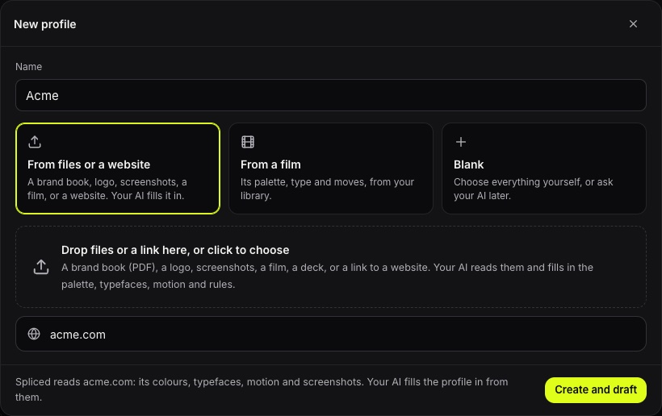

<!-- release 1.3.0 2026-11-25 -->

## Your own films in the Library
2026-11-25
*The films you made in Build have their own place in the Library, beat by beat, and the search box finds them.*

The films you made have a place in the Library: Your films, beside Favourites and With notes. Each film with a render
of the whole film shows its beats as scenes, marked Yours, playing their stretch of that render. They stay out of All,
so work in progress never crowds your inspiration. Search them there, or from anywhere with the search box (/), by
what is on screen, the copy and the voice-over. Open a beat to read its words and go straight to it in Build.
## The corner panel really closes
2026-11-25
*Closing the last finished import now takes the panel away, and folding works after it.*

When you closed the last row, or the whole panel, it stayed on screen with the old row in it, so the ×, the fold and
the panel's own × seemed to do nothing. It now goes away when you close it. The same fix keeps anything else the app
hides from staying on screen.

## Every change you ask for is kept
2026-11-25
*Several requests to your AI about a profile, sent close together, now all reach it.*

A second request sent while your AI was still picking up the first could be lost. Requests now wait in a list of their
own: your AI gets every one waiting when it starts, and one you send while it works gets a round of its own after.

<!-- release 1.2.0 2026-11-25 -->

## Closing the corner panel works again
2026-11-25
*A finished, failed or cancelled import closes with its ×, and the panel folds small again.*

In 1.1.0 a cancelled or failed import came straight back a moment after you closed it, so the ×, the panel's own ×
and the fold seemed to do nothing. Now what you close stays closed, also after a reload, and folding the panel hides
its rows.

## Profiles: the looks your films are made in
2026-11-25
*Keep the looks your films are made in, and choose one, or none, each time you copy a brief.*

Profiles, under Make, holds the looks your films are made in: your company's own, or one you want to try. New profile
sets one up in a click: drop a brand book, logo, screenshots or a film and your AI fills it in, start from a film in
your library, or start blank. On its page, tell your AI what to change in your own words, and it does. Each one
plays itself at the top of its page, in its palette and typefaces, with its motion. Choose the typefaces from the ones
on your Mac or from Google Fonts, each shown in its own face. Start the motion from one of the built-in motions, then
change the pace, bounce, stagger and float, and pick as many scene changes (sixteen, from a cut on the beat to a whip
pan or an iris) and ways for words to arrive (eleven, from typewriter to scramble) as fit the look, the first leading.
Each setting has a small picture of what it does, hovering a style plays it, and Reset takes you back. New makes a motion of your own that any profile can use. Colours and typefaces its
words already name are offered in one click. Add the scenes that show the
look from a picker that puts the closest palettes first, and take the palette from them in one click.

Drop a brand book, a logo, screenshots or a film on Profiles and your AI drafts a profile from them: palette,
typefaces, motion, its own words and its rules. Your AI keeps adding the rules it learns on every film.

Briefs start in the default profile (the switch at the top of a profile's page). A board, a scene's brief and a whole
film's brief each have a profile beside the copy button: pick another, or No profile to copy the reference as it is.
A reference film's page can start a profile from its look. A project that had one brand and house rules now has them
as its first profile, and the scene page says Recreate instead of Recreate for your brand.

<!-- release 1.1.0 2026-11-25 -->

## Recreate a whole film
2026-11-24
*A reference film's page has Copy build brief: one prompt for your AI to rebuild the film as closely as it can.*

The brief holds the whole breakdown: every scene with its timing, what is on screen, how it moves and how to recreate
it, and the film's palette, type, tempo and signature moves. It asks for a study, not a restyle: the same scenes in the
same order and length, in the film's own look rather than your project's house style. Your AI starts it as a board of
every scene (`board new "<name>" --from-film <film>`) and a film from that board, so Build plays each beat beside the
scene it recreates.

## What came in stays in the corner
2026-11-24
*When a film or an upload finishes, the panel in the bottom corner keeps saying so until you close it.*

It used to fold away after a few seconds, so a film that finished while you looked elsewhere went by unseen. Now each
finished import or analysis stays, with Open to go straight to it, also after you reload the page. Close one with its
own ×, or all of them with the panel's.

<!-- release 1.0.0 2026-11-24 -->

## Spliced is on npm
2026-11-24
*One line sets Spliced up: `npx -y spliced-app setup`. Nothing to clone.*

Spliced is published as `spliced-app`. Paste the setup message from the README to your AI, or run
`npx -y spliced-app setup my-films` yourself: about a minute later you have a project, the example film rendered and
the app open. `npm install -g spliced-app` gives you a `spliced` command instead. A running Spliced now tells you when
a newer version is out; turn that off with `"updates": false` in `spliced.json`.

<!-- release 0.1.0 2026-11-24 -->

## The example film shows only made-up material
2026-11-24
*The introduction film and the example film no longer show frames of a real brand film: the film they study is made up.*

The example needed a film to study, and used to borrow one company's own brand film for it. Now the library, the
board and the strip in the example show a film that doesn't exist ("Plan it together", for a product called Acme),
drawn in code by `demo_frames.py` beside the example. The film kit's specimens and the skills' examples use made-up
names too, and the UI sound kit's record keeps each sound's prompt but no link to the account that made it. Nothing
changes in your own project: a breakdown that still carries the old `takeaways_for_...` field is read as before.

## No more crackles in Build's playback
2026-11-24
*The reference beside the film no longer jumps around while it plays, which could break up the film's sound.*

To keep the reference in step with each beat, Build used to jump it back into place every time it drifted, as often as
twice a second in a fast montage. Every jump made the Mac decode a fresh burst of video, and on a busy Mac the film's
own sound could crackle, mostly near cuts and never the same way twice. The reference now keeps in step by running a
little faster or slower, and only jumps when a new beat starts or you scrub. The render itself was never affected.

## Removing one sound effect leaves the rest alone
2026-11-24
*Taking an effect out of a film no longer changes how its other effects sound.*

Each effect hit picks one of the kit's takes of its kind and a small level variation. They used to be dealt out in
order through the whole film, so removing one pop moved every later hit onto a different take and level. Now each hit's
take and level come from that hit alone: remove or add an effect, and only that effect changes. Films get one new
shuffle the first time their effects are built again.

## Sound notes in the Notes tab
2026-11-24
*Notes on an effect, the music or the voice now sit in the Notes tab with the frame notes.*

A note left on the sound used to show only in the Sound panel, and the Notes tab just said one was open. Now every
sound note is listed with the frame notes, in film order, marked SFX, Music, Voice or Mix with the sound it's about.
Its time plays the moment, and you can mark it done, delete it or open it in the Sound panel from there.

## Build plays through, with the render's own sound
2026-11-24
*Build now starts on Play through and Render, and a changed mix is picked up without reloading.*

Build used to start on Stems: it muted the render and played the film's tracks itself, from a list read when the film
was opened. After the sound was changed, the open page kept playing the old list, so a removed effect could still be
heard on a render that didn't have it. Build now plays the render's own sound unless you choose Stems, and when the
film's sound is written again (new effects, a new take) the Sound panel reads it again by itself. It also plays the
film through by default, the beats following the playhead; Loop beat (L) is one click away.

## Zoom in on the timeline
2026-11-24
*In Build, the beat bar and the sound lanes zoom in together, down to single frames, with the time written along them.*

The beat bar always showed the whole film, so on a long one the beats were slivers, the notes sat on top of each other
and a time could only be read by hovering. Now there is a ruler under it with the time marked, and you can zoom: the
magnifying glasses under the bar, the = and - keys (0 shows the whole film again), or a pinch or ⌘-scroll on the bar,
which zooms where the pointer is. Scroll sideways to move along, or drag the thin strip under the ruler, which shows
where you are in the film. The closer you go, the finer the ruler: seconds, half seconds, then frames with their
numbers. While the film plays, the view follows the playhead.

The Sound tab shares the same view. Its lanes have the same ruler along the top, zoom the same way, and name each
effect once you are close enough to read it. Beat still jumps to the selected beat.

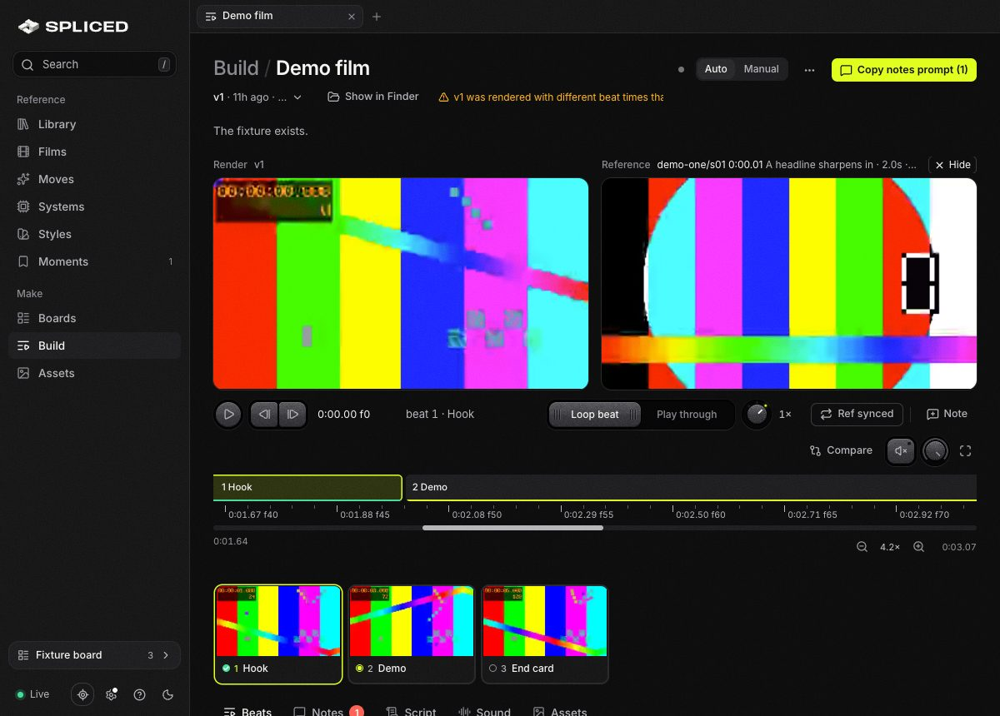

## A note on any scene, one key away
2026-11-24
*Open a scene and press N to write what you would steal from it and what you would change.*

Scenes could always carry a note of your own, but the field looked like a caption and was easy to miss. It is now
a box you can see, with a button beside the heart at the top of the scene (it lights up once the scene has a note),
and N puts the caret in it. The note is saved as you type. It shows as a mark on the scene's card, the Library's
With notes finds it, and it goes into the brief you copy, so your AI reads your take along with the breakdown.

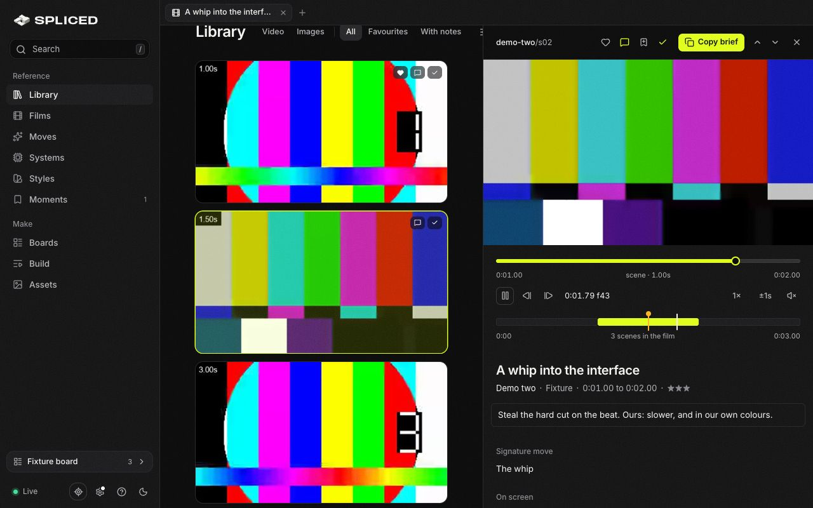

## The browser does what the Mac app does
2026-11-23
*Connect your AI, a real folder picker, a note when an import finishes, Recently viewed and New project now work in a browser too.*

Five things used to need the Mac app. In a browser, Setup now has Connect your AI: tick the agents and chat apps
that should get Spliced's tools, and it writes their settings. Add a folder opens your system's own folder picker
instead of asking you to type a path. When an import finishes while you are in another tab, the browser tells you
(it asks once whether it may), and the tab's title counts the imports still running. The tab strip has Back,
Forward and Recently viewed. And the project menu at the bottom of the sidebar has New project: choose a new or
empty folder, and Spliced makes the project and opens it. Dropping a folder on the window is the one thing still
only the Mac app can do, because a browser is never told where a dropped folder is.

## Your changes to a skill are kept
2026-11-23
*Spliced now remembers what it put in your project's skills, and never writes over a file you changed.*

`spliced agents install` used to replace Spliced's skills whole, your edits included. Now a skill file you have not
touched is updated quietly when Spliced is, and one you changed is left alone and named, in the command's output
and in Setup. `spliced agents install --force` replaces it anyway and keeps your version in `.cache/skills-kept/`.
Files you add to a skill's folder are never touched. Rules of your own are still better kept outside the skills, in
your project's `AGENTS.md` or `remotion/docs/HOUSE.md`, which the skills read first.

## Switch projects from the browser
2026-11-23
*The sidebar now names your project in the browser too, and its menu takes you to any other project you have opened.*

This used to be the Mac app's alone. In a browser nothing said which project you were looking at, and reaching
another one meant a terminal. Now the project's name sits at the bottom of the sidebar; click it for the projects you
have opened on this machine, newest first. Choosing one starts its app if it isn't running and takes the tab there.
The menu also makes a new project, and `spliced projects` lists them from a terminal.

## One command sets everything up
2026-11-23
*`spliced setup` goes from an empty folder to a rendered film: the project, your AI's skills, the film kit and the app.*

Starting used to be five commands in the right order. Now it is one, and it is what you paste to your AI: "Set up
Spliced in this folder: run `npx -y spliced-app setup`". About a minute later the example film is rendered and the app
is open. Run it again whenever you like: it only does what is still missing, and after an update of Spliced it brings
your project's skills and film kit up to date. It never turns a folder that already holds your files into a project;
name a new folder instead (`spliced setup my-films`).

## A film needs no service: voice and music from anywhere
2026-11-23
*Voice-over and music can come from any service your AI is connected to, from your own files, or be left out.*

Nothing outside your machine is needed to make a film: the motion library, the UI sounds and free footage come with
Spliced. Voice and music used to assume ElevenLabs. Now a voice is any voice service your AI can reach (name it in
`spliced.json` under `"voice"`, with `"provider"`), or your own recording, filed with `spliced voice file ... --plain
--source recording`. A music take is an audio file from a generator, from a track you have the rights to, or nothing
at all: the kit's sound recipe says how each is filed, and the arranging to your cuts is the same for all of them.
Setup now says plainly that these are extras.

## Spliced tells you when a newer version is out
2026-11-23
*In the browser, an Update button appears in the tab strip when a newer Spliced is out, with the command that gets it.*

The Mac app already updated itself; the browser version said nothing. Now a running Spliced asks once a day for the
newest version number (the request carries nothing about you or your project) and shows Update when there is one.
Settings has Check for updates, `spliced update` asks from a terminal, and Setup shows it as its second line. Turn it
off with `"updates": false` in `spliced.json`. When Spliced itself has been updated, your project's copy of its
skills is refreshed the next time you open it (a skill you changed is left alone).

## Two projects open side by side, and an app your AI can open
2026-11-23
*Each project now gets its own free port and keeps it, and `spliced open --background` starts the app and returns.*

Opening a second project, or having anything else on port 8765, used to stop Spliced with an error. Now a project
takes the port it had last time, or the next free one, and says where it is. For an agent, or a terminal you want
back, `spliced open --background` starts the app, opens it in your browser and returns with its address;
`spliced open --stop` stops it.

## Setup works on more machines
2026-11-23
*No Homebrew? ffmpeg now installs with one command and no password. Cursor and Gemini CLI count as your AI.*

On a Mac without Homebrew, Setup used to say only "install ffmpeg". It now gives a command that works there:
`uv tool install static-ffmpeg`, a ready-built ffmpeg that Spliced finds on its own. Setup also recognises Cursor and
Gemini CLI as your AI (it used to look only for Claude Code and Codex), every fix that is a command has a copy button
however Spliced is installed, and the hints Spliced prints name the command as you run it, `npx -y spliced-app`
included.

## The project's name moved to the bottom of the sidebar
2026-11-23
*In the Mac app, the project's name now sits quietly above the toolbar, out of the way of your work.*

With folders inside one project, and renders from a workspace landing in your project, there is little reason to
switch projects day to day. The name still opens the menu of projects when you need it (switch, open, make or close
one), and File, Open Project (⌘O) does the same.

## Gemini CLI works in your project too
2026-11-23
*Setup's Connect your AI (or `spliced agents install`) now gets Gemini CLI ready, next to Claude Code, Codex and Cursor.*

Gemini CLI opened in your project reads the same instructions as the others (a `GEMINI.md` that points at
`AGENTS.md`) and gets Spliced's tools (in `.gemini/settings.json`, beside any settings you already have there). The
first time, Gemini asks whether to trust the folder: say yes and the tools switch on. Its file tools are told to skip
your keys (`.geminiignore`). Several agents can now work on one film in the same folder, each reading the same plan.

## Renders from a workspace land in your project
2026-11-23
*A film rendered in a Conductor workspace (or any git worktree) now lands in your main project folder, where Spliced shows it.*

Each workspace is its own copy of your project, so a render made in one used to stay there: invisible when you opened
Spliced on your project, and gone when the workspace was archived. Now `spliced film render` in a workspace writes the
video into your main project's folder (the film's folder's `renders/`, or `remotion/out/`). The workspace still plays
it, and Spliced opened on your project lists the film under In other workspaces, with the workspace's name and branch,
until its branch is merged. Click it to play the render.

If you'd rather share finished videos through GitHub, set `"worktree_renders": "worktree"` in `spliced.json`: renders
then stay in the workspace and travel with its branch when you commit them.

## Folders for your films, boards and assets
2026-11-23
*Sort your work into folders, one per kind of video or one per client, and Build, Boards and Assets show it folder by folder.*

Make a folder with the + beside the folder filter, or `spliced folders add branding-videos`. It is a real folder inside
your project. Then open a film's menu or a board's menu and choose Move to folder. A film's renders go into its
folder's `renders/`, so you find them in Finder where you expect them; a HyperFrames film moves into the folder whole.
Pictures, clips and sounds you put straight into a folder show under it in Assets.

Build, Boards and Assets group by folder, and the filter above them shows one folder or everything; it stays the same
as you move between the three. A new board made while a folder is picked goes into it, and a film started from a board
goes where the board is. Everything not in a folder is Shared, and the Library is never sorted: every folder borrows
from all of it. Your AI follows the same folders: opened inside one, it starts its films and boards there.

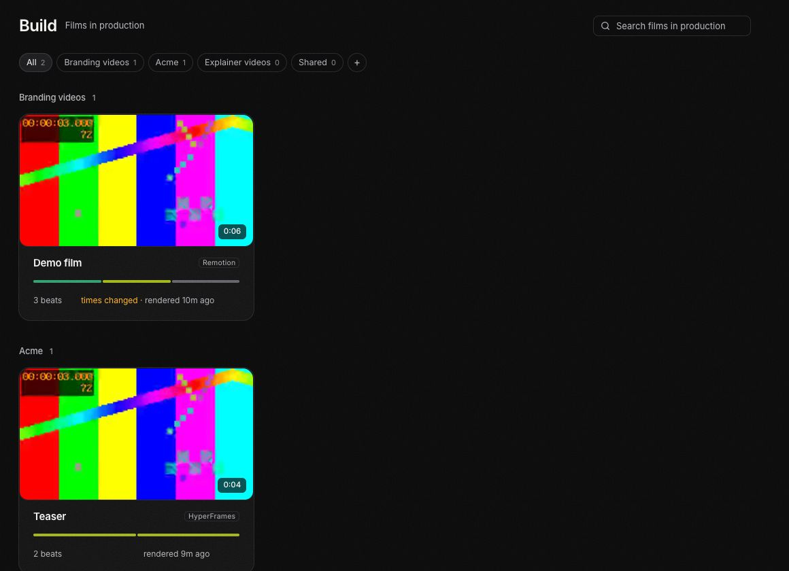

## Notes say when they were added; done ones can hide
2026-11-23
*Every note in Build shows its date and time, and one click takes the done notes off the bar under the film.*

A note in the Notes tab now says when it was added, a reply says when it came, and a done note says when it was
closed. Hover a time for the full date, or hover a marker on the beat bar to read the same there.

Done notes used to stay on the beat bar for good, so a film with a long history ended up with a row of green markers
around the few that still needed work. Hide done notes, at the right under the bar beside the film's length, takes
them off and leaves the open ones; the same button brings them back. Nothing is deleted: done notes are still in the
Notes tab, folded under the open ones as before. The choice is remembered, and it is in ⌘K too.

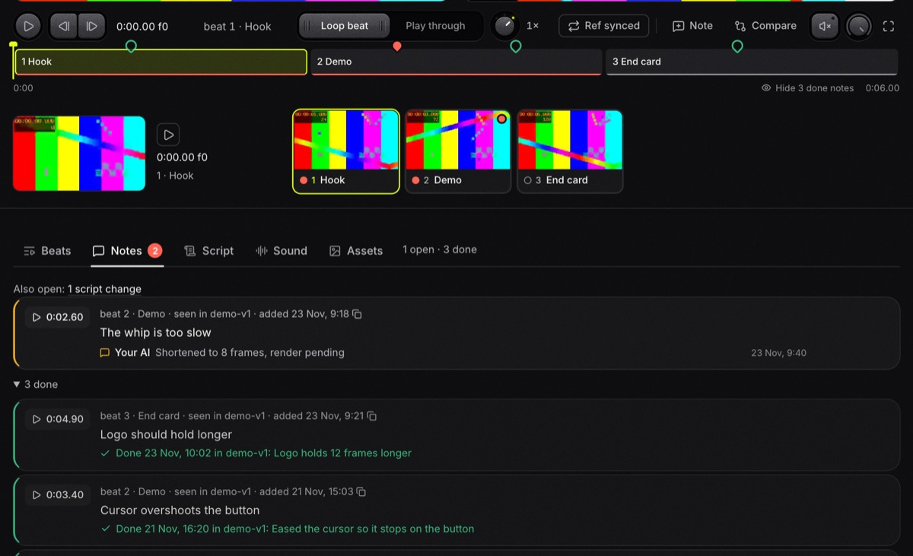

## Build no longer slows the Mac app down while it sits
2026-11-23
*A paused film in Build stopped redrawing itself, so the Mac app stays quick.*

Build rewrote its timecodes on every frame, even with the film paused, and each rewrite made the Mac app redraw the
transport's knobs. Left open on a film, it kept the Mac busy and everything felt laggy. The timecodes now change only
when the time does.

## Sound on is never silent
2026-11-23
*Turning a film's sound on in Build brings the volume knob back up if it was all the way down.*

The volume knob in Build's transport is remembered for each window, so a knob turned down to zero on another day
kept the film silent even with the sound key lit, and nothing said why. Now the sound key (or M) turns the level back
to full when it finds the knob at zero. Turn it down again from there as you like.

## Update app finds new changes from Applications too
2026-11-23
*A Mac app you built yourself and moved to Applications now offers Update app when there are new changes.*

A copy of Spliced built from a checkout used to know where its updates came from only while it stayed in that
checkout's `mac/build` folder: once moved to Applications it looked for a release instead, found none and said
nothing. It now remembers its checkout wherever it lives. Update app gets the new changes, builds the app again,
puts the new one where yours is and opens it with your projects. The app also looks again whenever you come back to it
after half an hour away, so new changes show up sooner. A copy made before this change has to be replaced by hand
once: build it again and move the new one to Applications.

## Switch projects in the Mac app
2026-11-22
*The Mac app now names the project you are in, and switches to another one from the same place.*

Under the logo, the sidebar shows this window's project. Click it for your recent projects: choosing one opens it in
this window in place of the one you are in. The same menu opens another project or makes a new one, shows the folder
in Finder, and closes the project to go back to the start window. File, Close Project (⇧⌘W) does that too. In the
command palette (⌘K) it is Switch project.

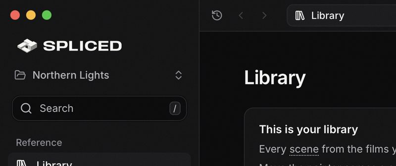

## Back and forward, service keys, and Update app
2026-11-22
*Each tab in the Mac app has its own back and forward, keys are pasted in the app, and the app updates itself.*

**Back and forward.** In the Mac app the arrows at the start of the tab strip, ⌘[ and ⌘], and a two-finger swipe
now take you back to the page you were on, and forward again, the way a browser tab does. Each tab keeps its own
history, and it survives the page reloading (it used to switch the buttons off).

**Service keys.** Settings has a Service keys section, and Setup offers it where a key is missing: paste your
ElevenLabs key (or a Pexels, Pixabay or Unsplash one) and it goes straight into this project's `.env`, readable only
by you and ignored by git. Spliced never shows it again: the app and `spliced keys` only say whether a key is set.
Your AI is told not to open `.env`, and Claude Code is set to refuse to read it. In a terminal, `spliced keys set
elevenlabs` asks for the key without showing what you paste.

**Update app.** When a newer Spliced is out, the Mac app shows Update app at the end of the tab strip (and in the
Spliced menu, Settings and the start window). It closes, updates and opens again with your projects. A copy built
from a checkout updates to the newest commits on its branch: it pulls them and builds the app again.

## Remotion installs itself
2026-11-22
*You no longer run `npm install` before you can render: Spliced installs Remotion when a project needs it.*

`spliced kit install` now puts the kit's packages in as well (Remotion and React, with npm). A project you clone,
a new worktree or a teammate's machine has the project's `remotion/` folder but not its packages: opening it in
Spliced starts installing them in the background, at exactly the versions the project's lock file names, and Setup
shows them as being installed until they are in. A render started before then installs them first instead of failing.
`spliced kit packages` does it by hand. Remotion is free for individuals and small teams and needs a company licence
above that; Spliced says so each time it installs it.

## Voice-over read by your AI, no key needed
2026-11-22
*If your AI is connected to ElevenLabs, it can now record a film's voice-over without a key in the project.*

`spliced voice record <film> --agent` gives your AI each changed line as a ready prompt, with the voice and model
from your project. Your AI reads it with its own ElevenLabs connector. Then `spliced voice file <film> <line> <files>`
takes the reads in exactly as Spliced's own recordings are: the line before it, read first so the tone carries
over, is cut away, every read is levelled to the same loudness, and each becomes a take you can pick in the
Sound panel. Setup now says this, so a missing key no longer looks like the end of the road.

Two smaller things. `spliced connect` run in a git worktree (a Conductor workspace, for one) now sends you to the
main checkout, since an app pointed at a worktree breaks when it is removed. `spliced film render` stops at once
with the fix when Remotion's packages aren't installed, and in a worktree it says that Spliced opened on the main
checkout won't list the render.

## Back, forward and recently viewed in the Mac app
2026-11-22
*The app's window gets the back and forward a browser has, a list of where you've been, and no title bar.*

At the start of the tab strip, the Mac app now has back and forward buttons (⌘[ and ⌘], or swipe with two fingers)
and a clock that opens **Recently viewed**: the boards, films, scenes and views you opened in this project, newest
first. Choose one to go there, or ⌘-click to open it in a new tab; ⌘Y opens the list from anywhere. In a browser
nothing changes, since it has its own back and forward.

The window no longer shows the project's name and folder across the top. The page runs to the top edge, the window's
buttons sit over the sidebar, and the empty part of the tab strip moves the window, as in other apps.

## A film kit, and an example film to start from
2026-11-22
*Spliced now comes with everything you need to make films, and a finished one to learn from.*

`spliced kit install` puts Spliced's film kit in your project: a motion library where a film asks for a role (an
entrance, a move, the camera) and a motion profile decides how it moves, every move as a specimen you can browse in
Systems, the recipes for craft and sound, and a set of crisp UI sounds. `spliced kit starter` adds an example film,
Spliced's own introduction, with its storyboard, its code and its sound, so you can open it in Build, render it and
borrow from it. Your own films and your own motion profiles stay yours: `spliced kit update` only replaces the
kit's files, and leaves any you changed by hand alone.

Ask your AI to make a film and it follows the new `make-film` skill, which reads your project's own house rules
first.

## Start without cloning anything
2026-11-22
*Spliced is an npm package now: one command and you are in.*

You no longer need to download Spliced's code to use it. `npx spliced-app init my-films` makes a project,
and `npx spliced-app open` opens the app on it. Or install it once with `npm install -g spliced-app`
and type `spliced` from then on. It uses the Python already on your computer, and if there isn't one, uv fetches it.

When you connect your AI to a project that you started this way, Spliced tells it to use the same npx command, so
it keeps working after npx has tidied up.

## Your library in the Claude app
2026-11-22
*Connect the Claude desktop app, Cursor or Codex to a project, and ask about it from any chat.*

Until now your AI reached Spliced by opening the project's folder. Chat apps don't open folders, so they keep a
list of tools of their own. Spliced can now add a project to that list: in the Mac app, **Connect your AI** in the
Project menu (or in Setup) shows the apps it found on your Mac with a box for each; from a terminal it is
`spliced connect claude-desktop`, `cursor` or `codex`. Then, in any chat, the app can search your library, read a
scene, and read or change a board, the same as an AI working in the folder.

Each project is added under its own name, so you can connect several. Everything else in the app's settings is
kept, and so is the file as it was before Spliced first changed it. Untick the box, or add `--remove`, to take a
project out again. Setup says which apps are connected.

## Spliced for Mac
2026-11-22
*A Mac app that opens each project in its own window, with nothing to install first.*

Spliced now comes as a Mac app too. Its start window lists your recent projects, opens a folder that is already a
project, or makes a new one, and you can drop a project folder on Spliced in the Dock. Each project opens in its own
window, and the projects you had open come back the next time you start it. Inside the window is the same Spliced
you know from the browser.

The window adds a few things a browser can't. **Add a folder** opens a real folder picker, and a folder dropped
anywhere on the window opens Add references on it. Downloads land in Downloads, and links to other sites open in
your browser. While films and folders come in, the Dock icon counts them, and a notification tells you when one is
done if you are working in another app. **Connect your AI** in the Project menu gives the AI you open in the project folder (Claude Code,
Codex, Cursor) Spliced's skills and its tools in one step. Everything Spliced needs to run is inside the app, so
there is no terminal and nothing to install before you start.

Your AI and the app see the same project: when the app is open, a change your AI makes to a board appears in its
window at once, whichever project it is. When a newer Spliced is out, the app says so in its Spliced menu and its
start window.

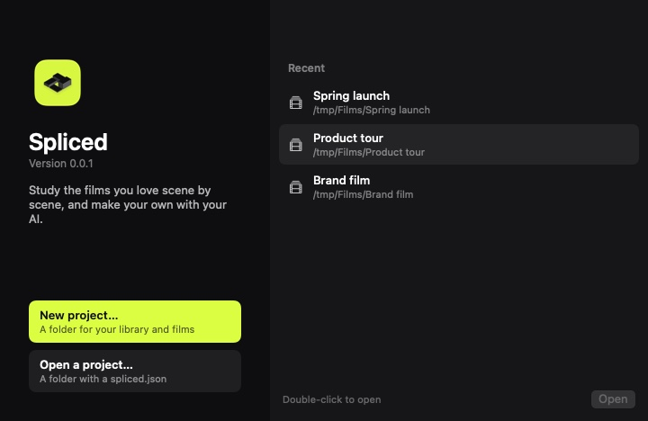

## Bring in a folder you already have
2026-11-21
*Point Spliced at a folder of pictures, clips and films, and it sorts them into the library.*

Most people arrive with a folder of things they have saved over the years. In Add references, **Add a folder**
takes its path, looks inside and tells you what is there before anything happens: how many pictures and GIFs, how
many videos. Then one button brings it in. Pictures and GIFs become uploaded references. Videos are sorted by
length: up to 15 seconds is a clip, one moment to borrow; anything longer is a film, cut into scenes like a link
you paste. Files are copied into the project, so nothing breaks when the folder moves, and your own folder is left
exactly as it was.

Each thing comes in once. Spliced tells files apart by what they hold, not by their names, so the same picture
saved twice is one reference, and running it again on the same folder only takes what is new. Looking, copying and
cutting films into shots happen on your machine and cost nothing; describing and tagging them is your AI's work,
and waits until you ask for it.

Your AI can do the same from the chat: "import my folder of references" (`spliced import <folder>`).

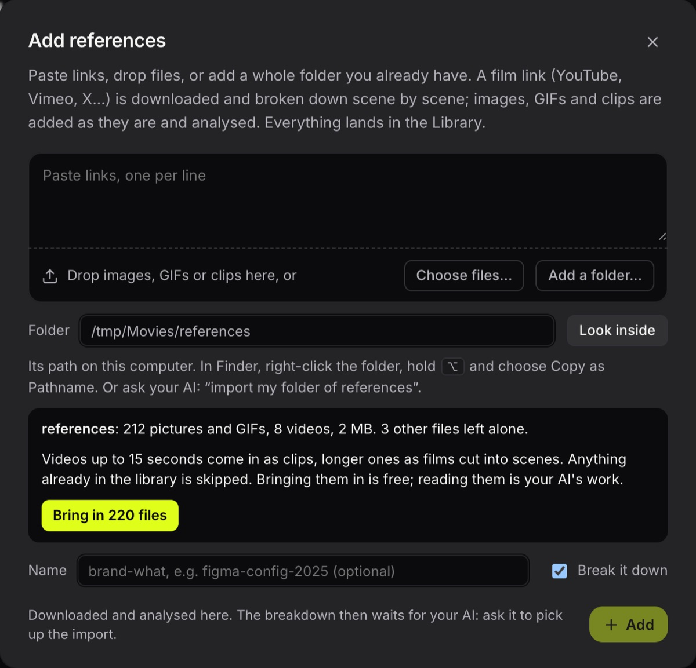

## Assets opens at once
2026-11-21
*The list of every still, clip and sound no longer makes you wait.*

Opening Assets used to mean reading every film's code again to see which files it uses, each time. Spliced now
keeps that answer and makes it again only when a file changes. On a project with 1,200 files, Assets appears in
a twentieth of a second instead of a fifth.

## The Library stays fast, however large
2026-11-21
*Thousands of scenes now open as quickly as a few hundred.*

The Library used to build a card for every scene before showing anything, and build them all again whenever
something changed. It now makes only the cards near the window; every other scene holds its place, so the page
is as long as before and the scrollbar still tells the truth. On a library of 5,000 scenes the first cards appear
in about a quarter of a second instead of a second and a half, a filter takes a blink instead of a third of a
second, and searching everything went from half a second to instant.

## Stacks: a render's frames as one card
2026-11-21
*A hundred frames of one render are one card in Assets, not a hundred.*

When a Blender or code render lands as numbered frames (`f_0001.png`, `f_0002.png` and so on), Assets now shows
them as one stack: the middle frame, how many there are, and the frames running under your pointer as you move
across it. Click a stack to see every frame; each is still its own file, opens on its own, and the arrow keys
step from one to the next. "Copy the path" gives the frames' path with `#` for the number, to hand to your AI.
Build's Assets tab and the global search show stacks the same way, and `spliced film assets` prints one line
per stack (`--frames` lists every frame).

The app also loads reliably on a busy machine now: it could come up without some of its scripts when many
requests arrived at once.

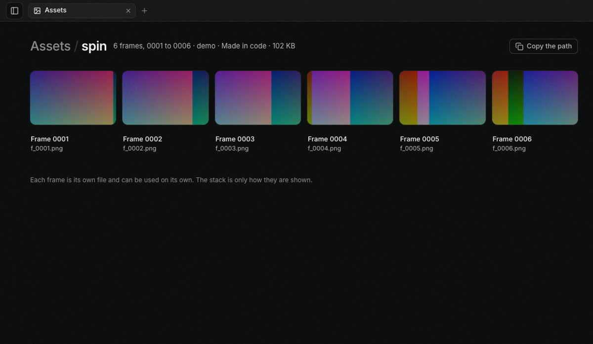

## A film to start with
2026-11-21
*The welcome now opens with a short film of how Spliced works.*

The first time Spliced opens, the welcome plays a 36-second film beside its three steps: paste a link, see it cut
into scenes, find a move, borrow it for your board, and build your own film next to what it borrows from. It
starts without sound; turn the sound on in the player. Open the welcome again with ⌘K, Welcome.

## Each view says what it is for
2026-11-21
*The first time you open Library, Boards, Build, Sound or Assets, a few lines explain it.*

Under the heading of each main view, a short note says what the view is for and the two or three things to try,
in plain words, with the film words explained on hover. "Got it" puts that one away for good. If you already know
your way around, "Hide all of these" puts every one away at once. They come back from Settings (View explainers),
and ⌘K, "About this view", shows the one for the view you are in.

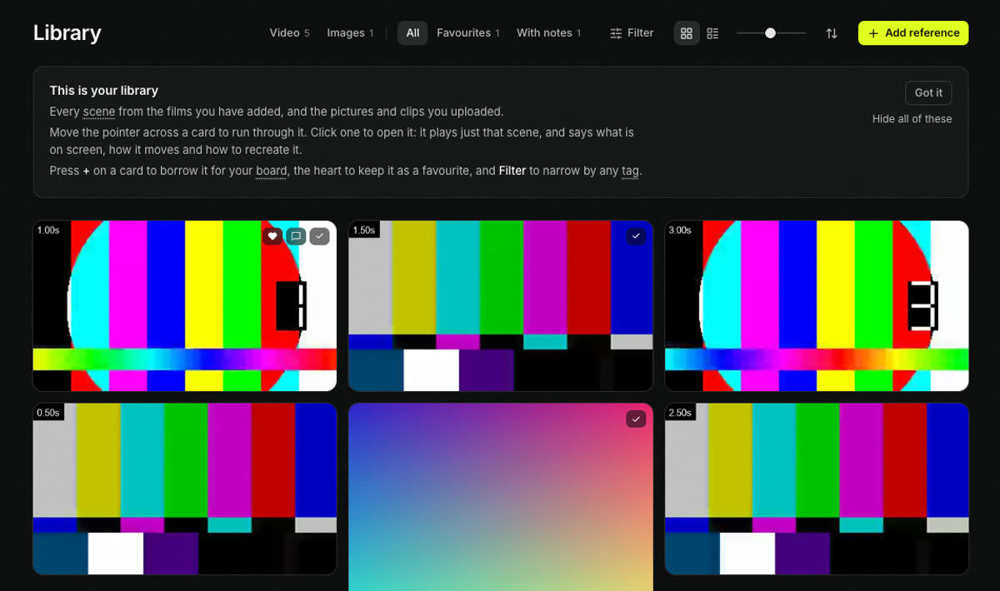

## Put the import history away
2026-11-20
*The Add reference sheet can hide what has finished, and keep only what is under way.*

Under the box where you paste a link, Add reference lists your recent imports. "Hide history" puts the finished
ones out of sight and leaves what is still downloading, being read, or waiting for your AI. It stays that way
until you choose "Show history".

## Search in every view, and one search for everything
2026-11-20
*Films, Moves, Boards, Styles, Build and every film's page have a search bar. ⌘K now finds the rest too.*

Each view that lists things has its own search bar, top right: type and what doesn't match steps aside. It
looks further than the titles. Boards are found by a line of their script, films in production by a beat or by
the note you left on one, films by their look or a named move. Leaving the view empties its bar, so you never
come back to a list that is quietly still filtered.

The global search (⌘K, or the Search field in the sidebar) now reaches everything: a single line on a board, a
beat of a film in production, a named move, a look from Styles, a film word. Choosing a result opens the place it
lives, already narrowed to it; a beat opens Build on that beat. Results are also stricter than before: a few
letters scattered across a long description no longer count as a match.

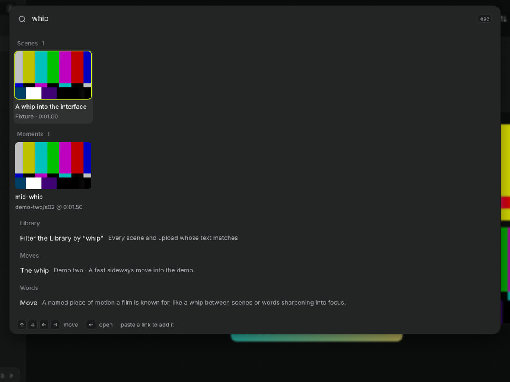

## The version you are running, and what changed
2026-11-20
*Settings shows which Spliced this is. This list opens from there.*

Settings now names the version of Spliced that is running, and the exact build when it runs from a checkout.
"What's new" opens this list, newest first. A dot on the Settings icon says there is something here you have
not seen yet.

## Your app's real code
2026-11-20
*Tell Spliced where your product's code is, and your AI rebuilds its screens from what really ships.*

The best source for a film's interface is the code behind it. A project can now say where that is, with
`"app": {"code": "~/code/your-app"}` in `spliced.json`: a folder on your machine or a GitHub address. Setup
shows it under Make films, and `spliced agents install` tells your AI to rebuild screens from the components,
styles and words that ship there, never from memory or a screenshot. GitHub now leads the list of what your AI
can be connected to.

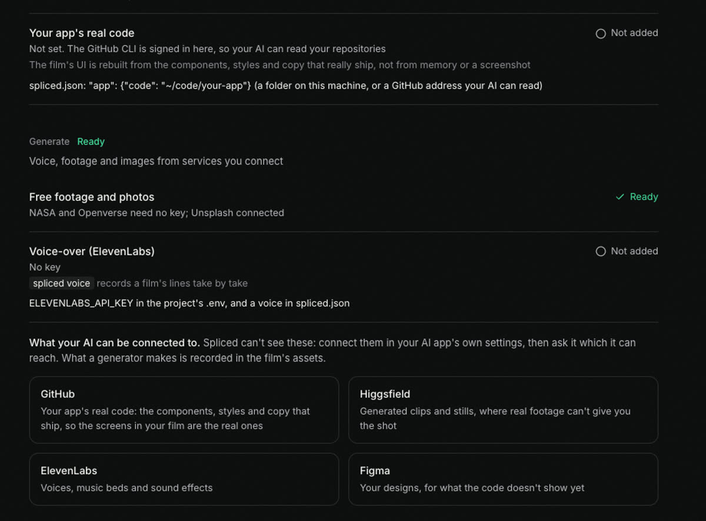

## The app explains itself
2026-11-20
*Faster tooltips everywhere, and a glossary for the film words.*

Every control now explains itself with the app's own tooltip: the first waits a moment, and moving from one
control to the next they are instant. Film-making has its own words, so the ones you meet here (beat, board,
take, bed, stem and a dozen more) are explained in plain terms. A word with a dotted underline shows its meaning
when you point at it, and the whole list opens from Settings or with ⌘K, Glossary. Each item in the sidebar
says what it is.

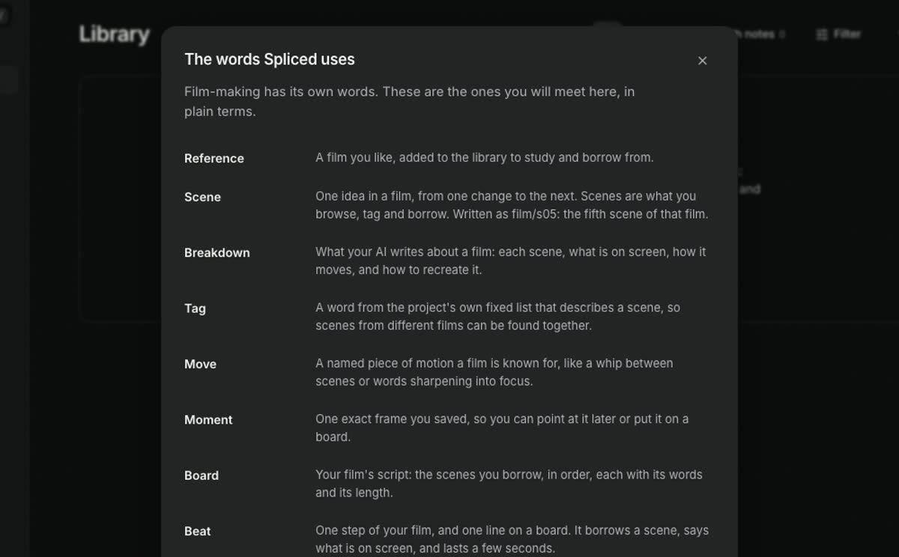

## It calls your AI by its name
2026-11-20
*The app no longer assumes you work with Claude.*

Where the app used to say "paste it into Claude" or "Claude is listening", it now names the AI your project
uses: "Claude" if your project has Claude read its imports, your own name for it if you set one with
`"agent": {"name": "..."}`, and "your AI" otherwise.

## A welcome for someone new
2026-11-20
*Three steps, shown once: collect films you love, connect your AI, make your own.*

The first time Spliced opens it says what it is and where to start. Each step leads to a real place and knows
whether you have already done it, so in a project that is under way it reads as a map. An empty library, an
empty board and an empty Build view now say what they are for and how to begin. Open the welcome again with
⌘K, Welcome.

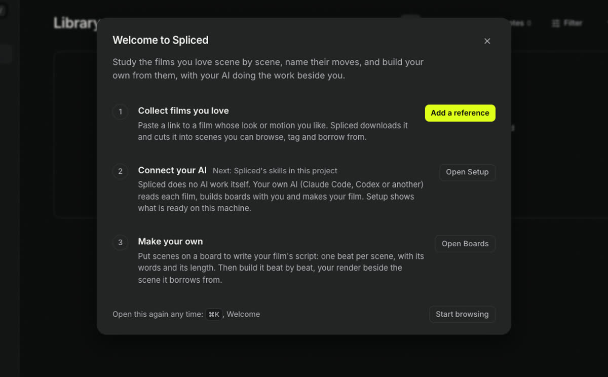

## Setup: what this machine can do
2026-11-20
*One screen that says what is ready, and the single step that unlocks the next thing.*

Setup lists what Spliced can do here, level by level: browse, collect, analyse, make films, generate. Nothing
beyond browsing is required. Every line says what it unlocks and how to add it, with the command to copy, and
"Copy for your AI" hands the whole job to your own AI, one step at a time. `spliced doctor` gives the same
answer in a terminal.

## Your AI gets Spliced's tools
2026-11-20
*Search the library, edit boards, read a film's notes and start a render, from any AI that speaks MCP.*

`spliced agents install` gives your project's AI what it needs: Spliced's skills, a section in the project's
`AGENTS.md`, and Spliced's own MCP server. With it, an AI that has no terminal can still search scenes, read
and change boards, file and close notes on a film, and render a beat in the background. It has been run with
Claude Code and with Codex.

## Imports wait for your AI
2026-11-20
*Adding a film no longer starts an AI in the background unless your project asks for that.*

When you add a reference, Spliced downloads it and cuts it into shots. The breakdown is your AI's work, and
by default it now waits for you to hand it over ("needs your AI", with the line to give it). A project that
prefers a background session says so in `spliced.json`, and that session is fenced in: it may read, edit
files in the project and run Spliced's own commands, nothing else.

## Spliced is its own tool
2026-11-20
*One command, `spliced`, working on any folder you make a project.*

Spliced no longer lives inside the films it was built for. Install it once, then `spliced init` makes any
folder a project with its own library, boards and films, and `spliced open` starts the app on it. With no
arguments, `spliced` lists everything it can do.

## Safer, and quicker to load
2026-11-20
*The app only answers its own page, and reloads cost almost nothing.*

The app's server now refuses requests from any other website open in your browser, and serves only pictures,
clips and sounds from your project: never its code, its settings or your keys. The library loads compressed
and is fetched again only when it has changed.
