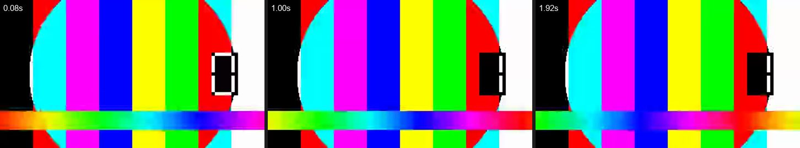
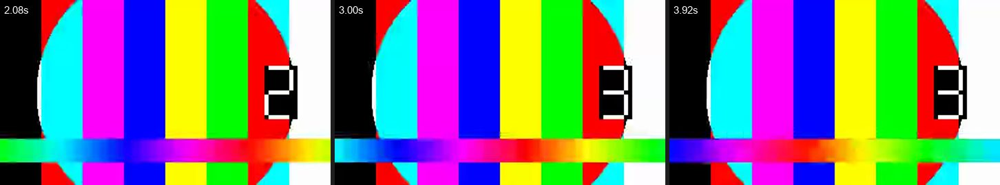

# Demo one

**Fixture** · product-launch · 16x9 · 0:04.0 · voice: on-screen-type-only · music: minimal-pulse

Source: made by tests/make_fixture.py · File: `reference/demo-one.mp4`

Four seconds of a test pattern, read as a two-scene launch film.

## Tempo

- BPM: 120 · average shot 2.0s · 30 cuts/min
- One cut, on the beat.

## Structure

Hook, then demo.

## Style signature

- **Palette:** `#FFFFFF` white stage
- **Type:** One grotesk.
- **Motion:** Arrive fast, land soft.

## Signature moves

### Sharpen in (s01)

Words arrive out of a blur.

*Recreate:* filter: blur() to 0.

## Scenes

| ID | Time | Scene | Role | Steal |
| --- | --- | --- | --- | --- |
| [s01](#s01) | 0:00.0–0:02.0 | A headline sharpens in | `hook` | ★★★ |
| [s02](#s02) | 0:02.0–0:04.0 | The product at work | `demo` | ★★ |

### s01

**A headline sharpens in** · 0:00.0–0:02.0 (2.0s) · steal ★★★

- **Tags:** `hook` `white-stage` `slow` `calm` · `none` in
- **Subject / camera / motion:** `typography` · `locked` · `blur-in`
- **Type / sound / production:** `centered-headline` · `free` · `code`
- **Palette:** `#FFFFFF` `#111111`

**On screen.** A headline sharpens in, centred on the stage.

**How it moves.** The headline sharpens in over half a second.

**Recreate.** A div and one blur-in.

### s02

**The product at work** · 0:02.0–0:04.0 (2.0s) · steal ★★

- **Tags:** `demo` `white-stage` `slow` `calm` · `hard-cut` in
- **Subject / camera / motion:** `ui` · `push-in` · `scale-up`
- **Type / sound / production:** `centered-headline` · `free` · `code`
- **Palette:** `#FFFFFF` `#111111`

**On screen.** The product at work, centred on the stage.

**How it moves.** The headline sharpens in over half a second.

**Recreate.** A div and one blur-in.

## Takeaways for Fixture

- Lead with the news.
- One idea per scene.
