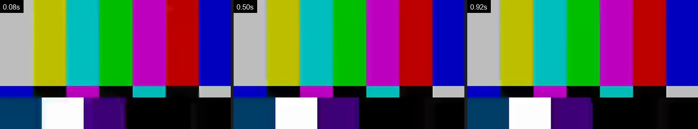
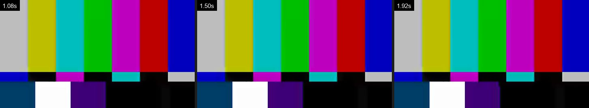
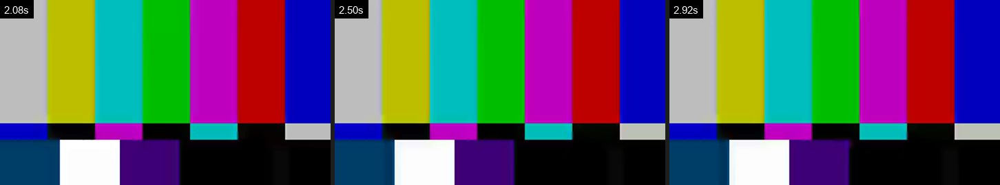

# Demo two

**Fixture** · explainer · 16x9 · 0:03.0 · voice: voiceover · music: driving-electronic

Source: made by tests/make_fixture.py · File: `reference/Demo two [abc123].mp4`

Three one-second scenes, cut fast. Its file name has a space and brackets on purpose.

## Tempo

- BPM: 140 · average shot 1.0s · 60 cuts/min
- A cut every second.

## Structure

Hook, demo, end card.

## Style signature

- **Palette:** `#111111` dark stage
- **Motion:** Whips between scenes.

## Signature moves

### The whip (s02)

A fast sideways move into the demo.

*Recreate:* translateX with motion blur.

## Scenes

| ID | Time | Scene | Role | Steal |
| --- | --- | --- | --- | --- |
| [s01](#s01) | 0:00.0–0:01.0 | Three words, one at a time | `hook` | ★★ |
| [s02](#s02) | 0:01.0–0:02.0 | A whip into the interface | `demo` | ★★★ |
| [s03](#s03) | 0:02.0–0:03.0 | The logo lands | `end-card` | ★ |

### s01

**Three words, one at a time** · 0:00.0–0:01.0 (1.0s) · steal ★★

- **Tags:** `hook` `dark-stage` `rapid-fire` `punchy` · `none` in
- **Subject / camera / motion:** `typography` · `locked` · `word-by-word`
- **Type / sound / production:** `centered-headline` · `cuts-on-beat` · `code`
- **Palette:** `#FFFFFF` `#111111`

**On screen.** Three words, one at a time, centred on the stage.

**How it moves.** The headline sharpens in over half a second.

**Recreate.** A div and one blur-in.

### s02

**A whip into the interface** · 0:01.0–0:02.0 (1.0s) · steal ★★★

- **Tags:** `demo` `dark-stage` `rapid-fire` `punchy` · `whip` in
- **Subject / camera / motion:** `ui` · `locked` · `blur-in`
- **Type / sound / production:** `centered-headline` · `free` · `generated-video`
- **Palette:** `#FFFFFF` `#111111`

**On screen.** A whip into the interface, centred on the stage.

**How it moves.** The headline sharpens in over half a second.

**Recreate.** A div and one blur-in.

### s03

**The logo lands** · 0:02.0–0:03.0 (1.0s) · steal ★

- **Tags:** `end-card` `dark-stage` `slow` `calm` · `hard-cut` in
- **Subject / camera / motion:** `logo` · `locked` · `blur-in`
- **Type / sound / production:** `no-type` · `free` · `code`
- **Palette:** `#FFFFFF` `#111111`

**On screen.** The logo lands, centred on the stage.

**How it moves.** The headline sharpens in over half a second.

**Recreate.** A div and one blur-in.

## Takeaways for Fixture

- Cut on the beat.
